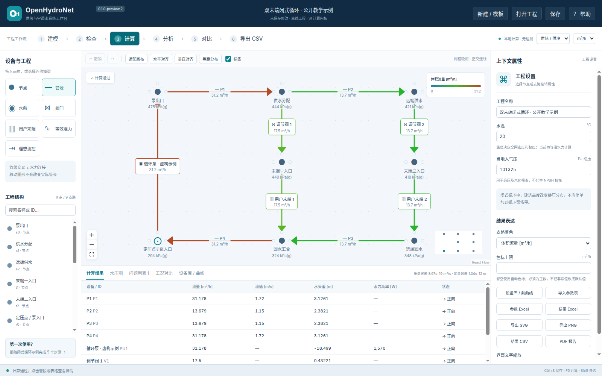

# OpenHydroNet

[ [English](README.md) | **简体中文** ]

[](LICENSE)
[](pyproject.toml)
[](https://github.com/wangzhichao-jpg/OpenHydroNet)
[](https://gitee.com/bigtaurus/OpenHydroNet)

**离线、中文、可解释的供热与空调水系统稳态分析工作台。**

> 当前版本：`0.1.0-preview.3`。本项目正处于功能持续演进的开源预览阶段，提供开箱即用的离线水力计算、拓扑建模与工况对比能力，适合方案比选、教学科研与工程辅助设计。在安全关键或实际工程设计中，建议结合工程规范独立复核。

OpenHydroNet 是一套面向供热管网与中央空调冷热水系统的离线水力计算与管网仿真分析软件。包含现代化的跨平台桌面交互界面（基于 Electron + React Flow）与高精度独立 Python 数值求解内核。

代码仓库：[GitHub](https://github.com/wangzhichao-jpg/OpenHydroNet) ｜ [Gitee 镜像](https://gitee.com/bigtaurus/OpenHydroNet)

## 当前核心功能

- **可视化拓扑建模**：从双末端闭式循环示例、最小系统向导或空白画布开始；支持端口智能吸附连线、正交自动布线、多选对齐、复制/粘贴、撤销/重做、管段自动拆分与快速插阀。
- **物理参数与设备编辑**：非模态属性面板，可实时编辑管道、循环水泵、Kv 调节阀及各类负荷末端；提供连通分量即时检查与输入有效性校验。
- **稳态水力求解**：独立子进程等温稳态求解，支持稀疏牛顿/回溯及 TRF 混合求解算法；实时查看支路流量、管内流速、节点表压、全流程水压图及带定位诊断的问题列表。
- **多工况对比与管理**：动态调整泵速与阀门开度，一键保存工况快照；支持基准工况与对比工况的绝对值、差值及百分比分析。
- **工程资产与设备库**：工程内置泵阀性能库，支持厂家离散性能点录入、二/三次 Q-H 特性曲线自动最小二乘拟合、RMSE 评估与有效扬程/流量区间限定。
- **表格映射与数据交互**：支持已有节点/设备的 CSV/XLSX 列名与工程单位映射导入、差异预览及撤销；一键导出工程 JSON、结果 CSV、矢量图（SVG/PNG）、计算书 PDF 及工程级 XLSX 报表。
- **分析工作区**（main 分支，尚未发版）：单/双参数稳态扫描（曲线与 CSV 导出）、找出影响最大调节量的敏感性矩阵、水力可及性（约束检查，及“尽量少调整、按设定精度取整”的有界局部搜索）、水力平衡（流量设定法求平衡阀开度、最低泵速与最不利环路，并经真实计算验证）；局部搜索结果不做全局保证。
- **Python 核心与 CLI 接口**：支持对称管网单线自动展开、参数批量稳态扫描、局部有界可行性搜索及灵敏度微分分析。
- **纯本地离线与隐私保护**：无遥测上报、无强制联网账号、无许可证服务器；核心求解完全在本地执行，进程通信严格限定在本机回环网络。

## 界面效果



上图为桌面工作台在公开示例下的实际计算与交互界面截图。另见 [设备库曲线拟合](docs/images/library-preview-2.png) 和 [参数映射导入](docs/images/import-preview-2.png)。

## 开发与本地启动

运行环境要求：Python >= 3.12、Node.js >= 22。第三方依赖经 `package-lock.json` 与 `requirements.lock` 严格锁定。

```bash
# 1. 准备 Python 虚拟环境与依赖
python3 -m venv .venv
.venv/bin/python -m pip install --index-url https://pypi.tuna.tsinghua.edu.cn/simple -e . pytest==9.0.2

# 2. 准备前端依赖与构建
ELECTRON_MIRROR=https://npmmirror.com/mirrors/electron/ npm ci --registry=https://registry.npmmirror.com
ELECTRON_MIRROR=https://npmmirror.com/mirrors/electron/ npm run setup:desktop
npm run build

# 3. 启动桌面应用
OHN_PYTHON="$PWD/.venv/bin/python" npm run desktop
```

Windows 环境开发可使用 `py -3.12 -m venv .venv`，并设置环境变量 `OHN_PYTHON` 指向 `.venv\Scripts\python.exe` 绝对路径。

## 独立计算内核调用与回归测试

```bash
# 命令行求解
PYTHONPATH=src python3 -m openhydronet.cli solve examples/closed-loop.ohn.json -o result.json

# 自动化测试与基准测试
PYTHONPATH=src OPENBLAS_NUM_THREADS=1 python3 -m pytest -q
npm run test:commands
npm run test:ui
PYTHONPATH=src python3 tools/benchmark.py
```

```python
from openhydronet import load_project, solve

# Python API 调用
project = load_project('examples/closed-loop.ohn.json')
result = solve(project['model'])
assert result['status'] == 'converged'
print("质量与能量残差:", result['residuals'])
```

## 标准示例基准值（Baseline）

在默认 20 ℃ 纯水工况、循环泵相对转速 1.0 时：
- 主循环总流量约 **31.178 m³/h**
- 泵扬程约 **18.499 m**
- 末端 T1 支路流量约 **17.500 m³/h**
- 末端 T2 支路流量约 **13.679 m³/h**（低于额定需求，系统诊断列表将给出提示）

## 构建与发布

- 官方仓库：[GitHub](https://github.com/wangzhichao-jpg/OpenHydroNet) ｜ [Gitee 镜像](https://gitee.com/bigtaurus/OpenHydroNet)。
- Windows x64 便携独立包构建流程参见 [构建说明](docs/BUILD.md)。
- 演示与操作说明视频参见 [媒体与视频记录](media/README.md)。

## 技术文档

- [中文用户手册](docs/USER_MANUAL.md) · [设备库与数据表导入](docs/LIBRARY_TABLES.md) · [物理模型与算法公式](docs/MODELS.md)
- [验证记录与精度基准](docs/VALIDATION.md) · [功能矩阵](docs/HACNET_PARITY_MATRIX.md)
- [项目状态](docs/PROJECT_STATUS.md) · [架构决策记录](docs/DECISIONS.md) · [已知限制](docs/KNOWN_LIMITATIONS.md)
- [版本路线图](docs/ROADMAP.md) · [依赖说明](docs/DEPENDENCIES.md) · [贡献指南](CONTRIBUTING.md)

## 作者与引用

项目负责人：[王智超](https://github.com/wangzhichao-jpg)（ORCID [0000-0001-6662-835X](https://orcid.org/0000-0001-6662-835X)），建科环能科技有限公司（国家空调设备质量检验检测中心）。  
联系与合作邮箱：[wangzhichao@chinaibee.com](mailto:wangzhichao@chinaibee.com)。

如果在论文、学位课题或工程报告中使用本软件，请按 [CITATION.cff](CITATION.cff) 引用（GitHub 仓库页面右侧 **Cite this repository** 按钮可直接导出 BibTeX / APA）。如果本项目对你的工作有所启发，欢迎在 GitHub 或 [Gitee](https://gitee.com/bigtaurus/OpenHydroNet) 点亮 Star，方便更多同行查阅。问题反馈与公开数据交流请提 [Issue](https://github.com/wangzhichao-jpg/OpenHydroNet/issues)。

### Author and citation

Project lead: [Zhichao Wang](https://github.com/wangzhichao-jpg) (ORCID [0000-0001-6662-835X](https://orcid.org/0000-0001-6662-835X)), Jianke Huanneng Technology Co., Ltd. (National Air-Conditioning Equipment Quality Inspection Center).  
Contact: [wangzhichao@chinaibee.com](mailto:wangzhichao@chinaibee.com).

If you use this software in academic papers or engineering reports, please cite it as described in [CITATION.cff](CITATION.cff). A star on GitHub or [Gitee](https://gitee.com/bigtaurus/OpenHydroNet) helps other engineers and researchers find it.

## 许可证与声明

本项目开源代码与技术文档均采用 [Apache-2.0](LICENSE) 许可证。内置第三方运行时及依赖均遵循其各自开源协议（详见 [依赖说明](docs/DEPENDENCIES.md) 与第三方声明清单）。演示算例与设备性能参数均为独立构造的通用测试与教学数据，不包含任何商业私有或未授权信息。
